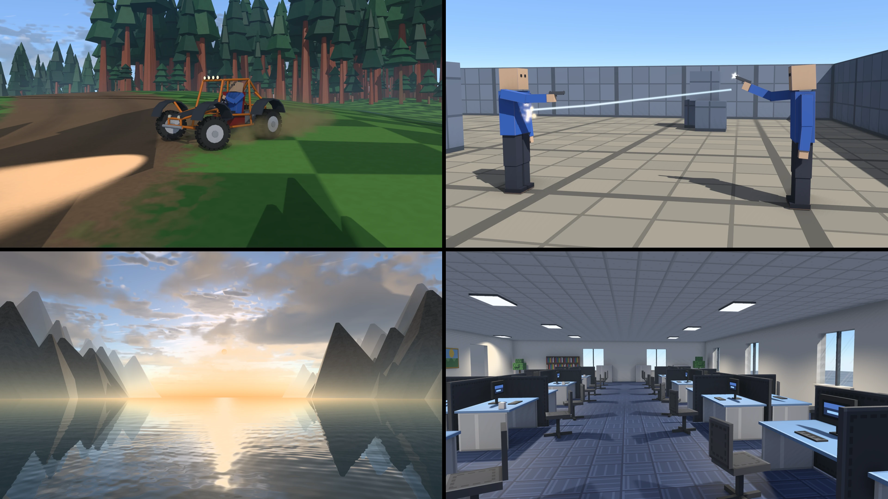

# torque-rs

> [!WARNING]
> torque-rs is experimental and not ready for real use. Its APIs, file formats and behavior change often and without
> notice, and nothing is published to crates.io yet.



- **Top left:** the vehicle demo. The buggy in a turn, with dust and tire tracks.
- **Top right:** the arena shooter. A bolt in flight, the muzzle flash, and the other player hit.
- **Bottom left:** the level demo's valley. The sea at sunset, with clouds reflected in the water and mountains in the distance.
- **Bottom right:** the level demo's office. Desks, ceiling lights, windows and glass.

Play the examples in your browser: https://reheatedcake.io/torque-rs/

A game engine library in Rust, based on the Torque Game Engine (TGE) and Torque3D, with features of its own. It has
TorqueScript and the console, SimObjects and datablocks, client/server networking with ghosting, DTS shapes, convex
collision and the game object model (players, items, projectiles, vehicles).

Games add their own console classes and functions, networked object types, render passes, file formats and resource
loaders through the engine's registries, and change engine behavior only through those hooks. Tools (editors, debugger,
telnet console, journaling) are build-time features, so a finished game can leave them out.

## Crates

| Crate | Description |
|---|---|
| `torque-ts-text` | the C-runtime text and number rules TorqueScript relies on |
| `torque-ts-bytecode` | compiled scripts (DSO files): reading, writing, decoding; dialect profiles |
| `torque-ts-compiler` | the TorqueScript compiler |
| `torque-ts-vm` | the TorqueScript runtime: the console's variables, namespaces, objects, natives and events |
| `torque-collide` | convexes, GJK, polygon lists, working sets, object type masks |
| `torque-shapes` | DTS shapes and DSQ sequences |
| `torque-shape-builder` | a builder of shape models from code: nodes, box and prism meshes, skin meshes, details, materials and sequences |
| `torque-modelcore` | the format-neutral model layer: nodes, meshes, skins, materials, detail levels, sampled animations |
| `torque-import` | model readers and writers: glTF 2.0, OBJ and Blockbench into the model layer, the model layer into `.dts` shapes and back; native glTF shapes |
| `torque-convert` | the converter command: models (glTF, OBJ, Blockbench, DTS) into `.dts` or `.glb`, `.map` brushes into interiors |
| `torque-sim` | the process list, Player, AIPlayer, Item, Projectile, ShapeBase images |
| `torque-vehicle` | rigid bodies, wheeled and flying vehicles |
| `torque-scene` | the scene container: bins, searches, a scene object's transform math |
| `torque-resource` | the resource layer: a game folder, its zips mounted as folders, the scripts' writes in memory |
| `torque-game` | the TGE game classes as console classes: scene objects and their container, shapes, players, items, vehicles |
| `torque-server` | a dedicated server's main-loop pacing, platform values and transports (UDP, WebSocket, WebRTC data channels) |
| `torque-client` | the client's engine half: the connection to a server, the prediction, action maps, the server query, window glue |
| `torque-mapcore` | the format-neutral map layer |
| `torque-maps` | Torque interior, terrain and material-list files; a `.dif` writer |
| `torque-interior-builder` | interiors (`.dif`) built from brushes made in code or read from a `.map`, or from glTF, OBJ and Blockbench meshes |
| `torque-content` | the content formats as asset-loader plugins: glTF, OBJ and Blockbench shapes, `.dif`, `.ter`, the map layer, `.map` interiors |
| `torque-net` | NetConnection, ghosting, events, BitStream, string compression |
| `torque-ghosts` | ghost record codecs: the layout framework, the class registry, the parent parts and the engine's object layouts |
| `torque-ghost-world` | the client's world of ghosts: records merged, datablocks, the control object, mounted images, script threads, effects |
| `torque-gui` | the GUI object model: controls, the canvas, layout and the script methods of GUI classes |
| `torque-images` | image decoding |
| `torque-fonts` | font caches and text rasterizing |
| `torque-audio` | audio decoding and mixing |
| `torque-render-core` | the renderers' device layer: the GPU, offscreen targets, a frame read back, a window's surface, the GUI pass |
| `torque-render-scene` | a frame as plain data: the camera, the sun, textures and draws with their fixed-function state; maps, shapes, particles, decals, tire tracks and the HD renderer's scene |
| `torque-render-hd` | the HD renderer on the GPU: shadows, sky and clouds, water, reflections, AO, TAA, bloom and exposure |
| `torque-app-server` | the server half of `torque-app`: its files, a server, the terrain and water blocks, the dedicated runner and `MinimalPlugins`; no drawing, GUI, audio or window crates (CI checks its dependency tree) |
| `torque-app` | what a game made on the engine shares: its files, a server, a client, a window, the world view and offscreen pictures (needs a GPU) |
| `torque` | the umbrella crate: the crates above behind features, and headless examples |
| `torque-example-minimal` (`examples/minimal`) | a dedicated server and a client over the loopback address, wired by hand on the lower crates (`just examples/min-server`, `just examples/min-client`) |
| `torque-example-assets` (`examples/assets`) | the example games' asset kit: a cube, a box figure, a pistol, a buggy, terrains, trees, interiors and their textures, made from code (`just examples/assets`) |
| `torque-example-common` (`examples/common`) | what the example games share beyond `torque::app`: the kit as files, the shared scripts, the prediction over the kit's cubes and interiors |
| `torque-example-character` (`examples/character`) | an animated box figure in a window, with an orbit camera |
| `torque-example-level-demo` (`examples/level-demo`) | a singleplayer world: a menu of maps (cubes, a Blockbench office, the valley), native and in the browser |
| `torque-example-fps` (`examples/fps`) | an arena shooter for a few players: LAN, internet, and browsers over WebSocket and WebRTC |
| `torque-example-vehicle-demo` (`examples/vehicle-demo`) | a buggy to drive over hills on a race track through forests, alone or with others |
| `torque-example-showcase` (`examples/showcase`) | the pictures at the top of this page, drawn offscreen |

The roadmap is in the guide (`book/src/roadmap.md`).

## What torque-rs adds to TGE and Torque3D

The parts that follow TGE 1.4 or Torque3D (TorqueScript, the console, datablocks, ghosting, DTS, DIF and legacy terrain
files, the game classes' physics) match their behavior and are credited where they are used. The features below are new.
Some are options beside the original behavior.

- **HD renderer** (`torque-render-hd`). The fixed-function renderer is still there for the original look. The HD one has:
  - cascaded sun shadows and contact shadows;
  - a physical sky with volumetric clouds (`CloudLook`);
  - particles lit by the sun, the sky and lights;
  - TAA, ambient occlusion (GTAO or SSAO) and spot lights with shadows;
  - water with waves, refraction, reflections and sun glint;
  - bloom and automatic exposure;
  - four quality levels, Low to Ultra.

  A scene can also turn on ground textures that hide visible tiling, and clouds that move faster than the clock (a
  timelapse). The sun follows a server's `TimeOfDay` under a `ScatterSky` (classes from Torque3D).
- **Interiors from more sources** (`torque-interior-builder`). It builds `.dif` interiors from brushes made in code, from
  Quake or Valve 220 `.map` files, and from glTF, OBJ or Blockbench meshes. Blockbench textures can be drawn the way
  Blockbench draws them: nearest-sampled, with see-through pixels for glass.
- **Model import and conversion** (`torque-import`, `torque-convert`). glTF 2.0, OBJ and Blockbench models convert to
  `.dts` (and `.dts` to `.glb`), with skins and sequences. `torque-convert` is the command-line tool.
- **Web build.** The level demo, the arena and the vehicle demo run in the browser on WebGPU. A build loads its files by
  URL from a list (`files.json`, with sizes and SHA-256 hashes, cached by the browser) or embeds them in the module. The
  arena's server takes browsers over WebSocket and WebRTC alongside desktop players on UDP, in the same game.
- **Hitboxes with lag compensation** (`torque-game`, opt-in). A Player can be hit on its posed shape instead of its box,
  and the server can check a shot against where the shooter saw the other players.
- **Vehicles on the client.** Tire tracks (TGE has none), wheel dust (TGE's emitters), and other players' vehicles drawn
  smoothly between updates, with corrections spread over the next ticks.
- **Camera blend** (`torque::app::camera_blend`). The camera moves smoothly between first and third person instead of
  cutting, and stays out of walls and the ground.
- **App layer** (`torque-app`). The pieces every game needs: its files in memory, a server, a client, a window, the world
  view and offscreen pictures for tests. The example games build on it.

## Examples

The example games are in [`examples/`](examples/README.md), with pictures, their controls, and how to run each natively
and in the browser. In short:

| Example | Native | Web |
|---|---|---|
| The level demo (plaza, maze, ramps, towers, office, valley) | `just examples/level-demo` | `just examples/web-level-demo` (`?map=valley`) |
| The arena shooter | `just examples/fps-client` | `just examples/web-fps` |
| The vehicle demo | `just examples/vehicle-demo` | `just examples/web-vehicle-demo` |
| The character | `just examples/character` | |
| The minimal server and client | `just examples/min-server`, `just examples/min-client` | |

## Building

Requires Rust (edition 2024) and [just](https://github.com/casey/just). [mdBook](https://rust-lang.github.io/mdBook/) for
the guide.

```
just build      # build the workspace
just test       # run the tests
just doc        # API reference (rustdoc)
just book       # the guide (mdBook), into target/book
just ci         # everything CI checks
```

## License

MIT; see [LICENSE](LICENSE). Some file formats and behaviors follow Torque3D (MIT, Copyright (c) 2012 GarageGames, LLC),
credited where they are used and in [NOTICE](NOTICE).

## Contributing

See [CONTRIBUTING.md](CONTRIBUTING.md); report security issues as [SECURITY.md](SECURITY.md) describes. Changes are
listed in [CHANGELOG.md](CHANGELOG.md).
