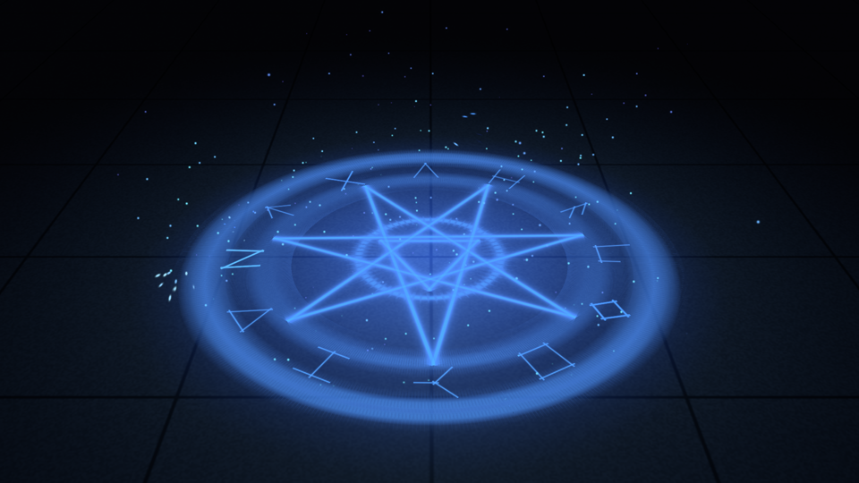

# Particles showcase

A window of GPU particle effects at the High look (the fog at Ultra), fifteen tabs: every texture and shape is made in the
example, and each effect is particle datablocks as the client holds them plus a script that moves their emitters.



## Run

```sh
cargo run -p torque-render-hd --release --example particles-showcase
```

Record the clips headless instead (frames as PNGs, one folder a clip, with each clip's particle count and GPU time):

```sh
cargo run -p torque-render-hd --release --example particles-showcase -- --record out --size 1920x1080 --fps 30
cargo run -p torque-render-hd --release --example particles-showcase -- --record out --clip fireworks --seconds 20
```

`--bare` records a stage with its effect stepped but not drawn, to diff a clip against (a glow must only add light).

Check every show builds and draws headless: `-- --check`.

## Controls

The tabs are sparks, smoke, fireflies, the magic circle, a portal, the railgun, fireworks, an explosion, a lightning storm,
a fountain, volumetric fog, lava, petals, a galaxy and digital rain. Keys `1` to `9` and `0` pick the first ten; `Page Down`
and `Page Up` step through all fifteen. `Space` nudges the tab that has a trigger: it traces the circle again, fires the
railgun, sends up a shell, sets off the charge, calls a strike, surges the fountain, pops a lava bubble or brings a gust.
Drag with the left mouse button to orbit the camera; the wheel moves in and out; `R` puts it back. `Escape` closes.
