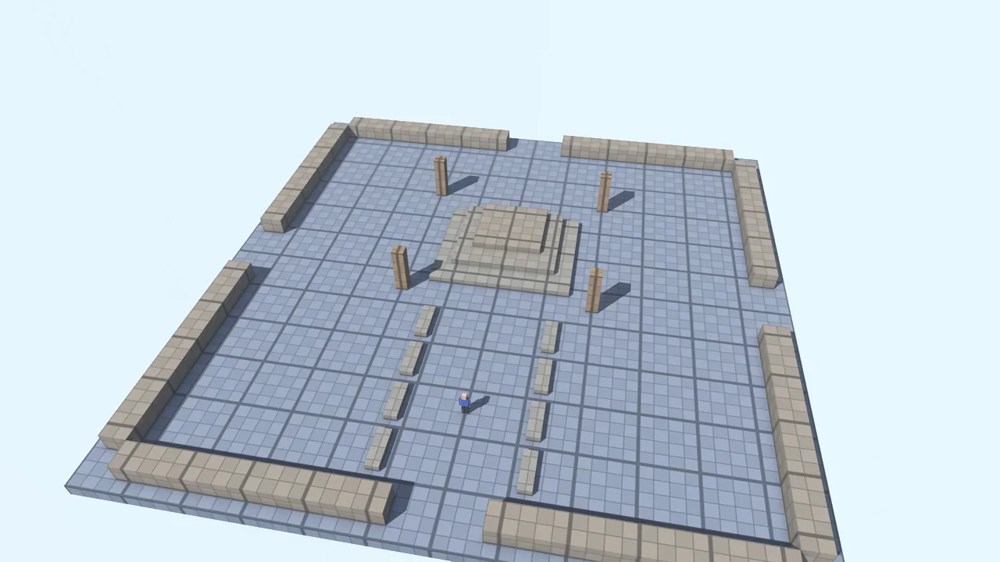
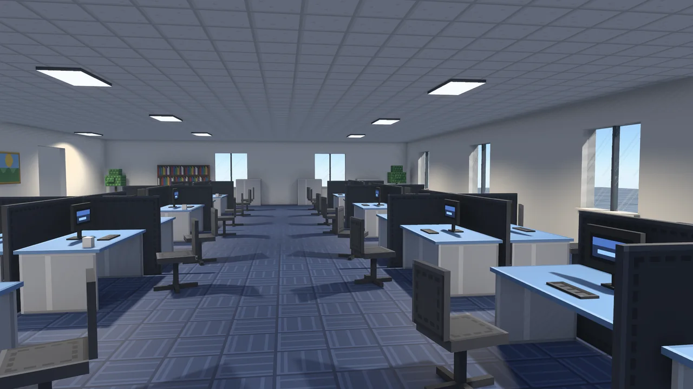
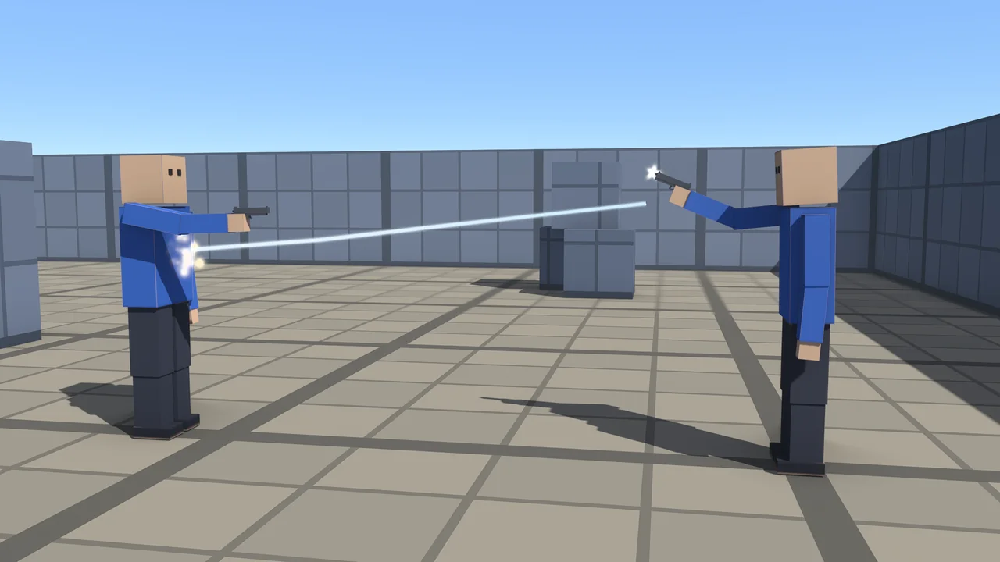
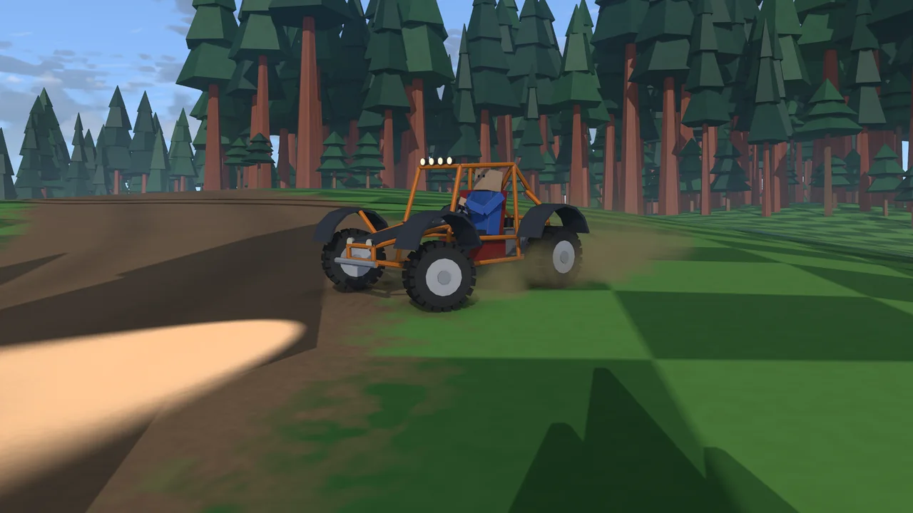
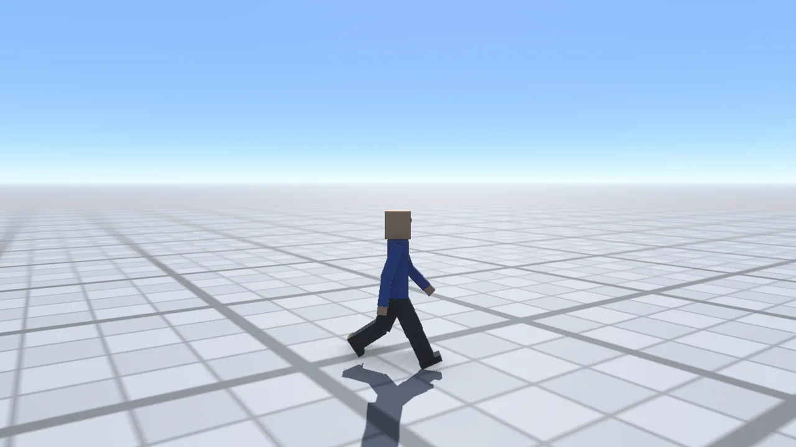
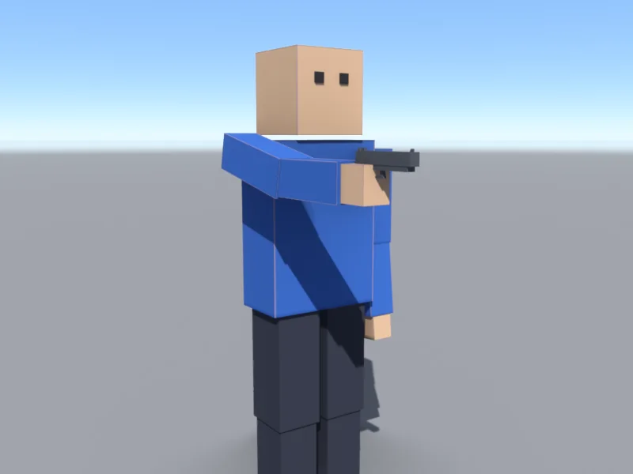
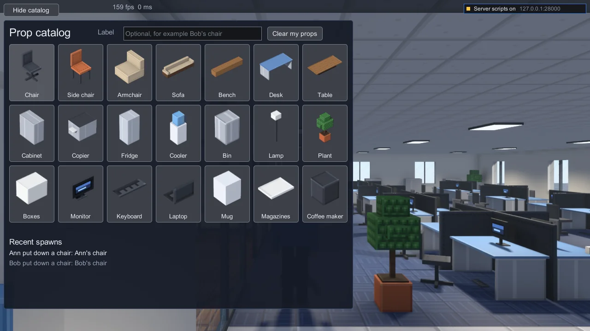
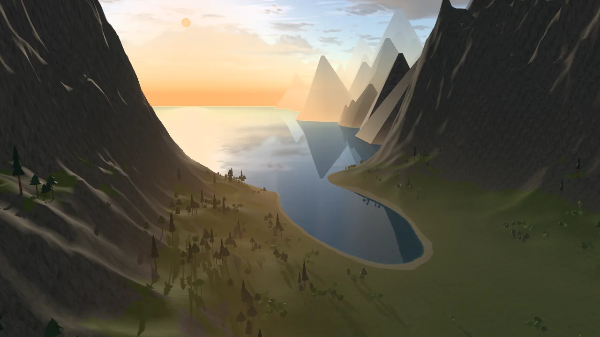

# Examples

Small games made with the engine. Each uses the asset kit (shapes, textures, terrains and trees generated by code at
startup, so no asset files are in the repository) and the app layer (`torque::app`: files in memory, a server, a client,
a window). Every picture here is drawn offscreen by the example itself, without the HUD (`just examples showcase shots` and
`just examples showcase shots <dir> --examples`, see [The pictures](#the-pictures)).

Run the recipes from the repository's root (`just examples <example> <recipe>`) or from this folder (`just <example> <recipe>`); each example's folder has its own justfile too (`just <recipe>` inside it, `just --list` names them). Each recipe is
a plain `cargo run`, shown beside it. The web builds need rustup's `wasm32-unknown-unknown` target and Node; the first build
installs wasm-bindgen's command line into the target folder.

<table>
<tr>
<td align="center"><a href="#the-level-demo"> The level demo</a></td>
<td align="center"><a href="#the-level-demo"> The office</a></td>
<td align="center"><a href="#the-valley"> The valley</a></td>
<td align="center"><a href="#the-arena-shooter"> The arena shooter</a></td>
</tr>
<tr>
<td align="center"><a href="#the-vehicle-demo"> The vehicle demo</a></td>
<td align="center"><a href="#the-character"> The character</a></td>
<td align="center"><a href="#the-asset-kit"> The asset kit</a></td>
<td align="center"><a href="#the-prop-catalog"> The prop catalog</a></td>
</tr>
</table>

Also, without a picture: [the minimal server and client](#the-minimal-server-and-client), a dedicated server and a console client that prints its ghosts; [the minimal example on the engine](#the-minimal-example-on-the-engine), the same game with the engine doing the wiring; [the mods demo](#the-mods-demo), a game mode shipped as a mod that the server requires; [the native extension](#the-native-extension), a plugin built apart from the engine; [the format viewer](#the-format-viewer), pictures of Source engine content.

## The level demo

A single-player game: pick a map from the menu, then walk and jump around it as the box figure. The server and the
client run in one process and talk over an in-memory link, so the full network path runs without a socket. The maps are
TorqueScript mission files (`level-demo/game/missions/`). The plaza, the maze, the ramps and the towers are built of cubes.
The office is a Blockbench model (`game/levels/office.bbmodel`) built when the game starts: the building into interiors,
with glass and ceiling lights, and every chair, desk, table, sofa, cabinet, plant and desk item into a prop
(`torque-plugin-props`) that the figure pushes when it walks into it, and a left click picks up a light one (a chair, a
plant, a monitor) and carries it, arm held out, in front of the figure and following where it looks up or down; a second click drops it. The demo speaks the engine's own network protocol,
which carries the props. The valley is a terrain with a lake (below).

**Controls:** 1 to 9 pick a map on the menu; W A S D walk, Shift sprint, Ctrl hold to crouch, C crouch or stand, Z lie down or get up (Space or C gets up), Space
jump, mouse look, left click pick up or drop a prop (the office), Tab first or third person (the camera eases between them), R
restart, Esc back to the menu.

**Run it:**

| | Recipe | Command |
|---|---|---|
| Native | `just examples level-demo run` | `cargo run -p torque-example-level-demo --release` |
| Web | `just examples level-demo web` (serves it on http://127.0.0.1:8080/; `?map=office` starts a map at once) | `node web/build.mjs level-demo` |
| Web, files inside the module | `just examples level-demo web-embedded` | `node web/build.mjs level-demo --embed` |
| Web, online | [the gallery](https://reheatedcake.io/torque-rs/): the plaza, the office and the valley | `just site` |
| Pictures | `just examples level-demo shots`, `just examples level-demo valley-shots` | `cargo run -p torque-example-level-demo --release -- --shots <dir>` |
| With a rope across the plaza (`torque-plugin-rope`) | `just examples level-demo rope-shots` (pictures) | `cargo run -p torque-example-level-demo --release --features rope` |
| The office's prop catalog | see [the prop catalog](#the-prop-catalog) | |

**Shows:** a server and a client in one process; missions loaded from TorqueScript; the client's prediction against cubes,
interiors and terrain; interiors and props built from a Blockbench model (nearest-sampled textures, see-through glass,
furniture the figure pushes, predicted on the client); spot lights with shadows; the camera blend; the web build with its
files fetched by a list and kept in the browser's cache.

### The valley

A level demo map (6 on the menu). A lake lies in a long valley between mountains and opens out to the sea. The sun is
low over the water, trees grow on the lower slopes, and the clouds move 150 times faster than the clock, so their shadows
cross the slopes as you watch. The terrain, its grass, rock and sand textures, and the trees are generated by the asset
kit (`assets/src/valley.rs`). The map is `level-demo/game/missions/valley.mis`.

**Run it:** as the level demo, then 6; in the browser `just examples level-demo web` and open
http://127.0.0.1:8080/?map=valley. Its pictures and their GPU frame times: `just examples level-demo valley-shots`;
eight seconds of its sky moving: `cargo run -p torque-example-level-demo --release -- --valley-clip <dir>`.

**Shows:** a legacy terrain (`TerrainBlock`) with blended materials, also used for collision on the client; a
`WaterBlock` drawn with the HD renderer's water (waves, reflection, refraction, sun glint); a `TimeOfDay` held at sunset
under a `ScatterSky`, with volumetric clouds on a faster clock; ground textures that hide visible tiling (opt-in, per
map); a few tree and grove interiors placed hundreds of times.

## The prop catalog

A menu that the office's server gives to its players. The server has a catalog of the office's props (chair, sofa, desk, plant,
monitor, mug and fifteen more), each with a picture. The picture files and the menu's script are a mod (`level-demo/catalog/`)
that the server requires, so a client downloads it when it joins. The menu's script is
Lua and runs on the player's machine, in a sandbox, so before anything of it runs the client asks the player. The prompt says
the server wants to run scripts and lists what the menu asks for (show menus, talk to the server); the player picks Allow, Not
now or Never for this server.

Once allowed, the catalog opens over the game. Clicking a card asks the server to put that prop down in front of the player. The
menu only asks: the server's script (`catalog/server.cs`) decides. It checks that the kind exists, that the label uses only
letters, numbers, spaces and a few marks and is at most 32 characters, that the player has fewer than 4 props out and has not
asked more than 3 times in 5 seconds, and that there is room in front of the figure. Then it spawns the prop (`propSpawn`),
owned by that player. A refusal shows in red under the cards. The "Recent spawns" list under them shows the last five spawns of
every player, newest first. The pictures on the cards are drawn from the props' own shapes (`just examples level-demo catalog-icons`).

**Controls:** Q opens or closes the catalog; Esc hides it (the game's own menu does not open); click a card to put that prop
down in front of you; type in the Label box first to give it a label; Clear my props takes back the ones you put down (only
yours); the Hide catalog button at the top left does the same as Esc, with the mouse. Shift and Esc together turn the server's
scripts off for the connection.

**Run it:** it is native only (not in the level demo's window, nor the web build) and has no window of its own: the example plays a
short session with two clients, Ann and Bob, who allow the menu and spawn a chair each, and prints what each one shows. The
keys above are what the client binds; the example's tests press them.

| | Recipe | Command |
|---|---|---|
| Play the session, headless | `just examples level-demo catalog` | `cargo run -p torque-example-level-demo --release --example level-catalog` |
| Pictures (the prompt, the catalog, a label typed, the list of spawns, a chair in the office, a refusal) | `just examples level-demo catalog-shots <dir>` | `... --example level-catalog -- --shots <dir>` |
| The tests | `just examples level-demo catalog-test` | `cargo test -p torque-example-level-demo --test catalog -- --include-ignored` |
| The cards' pictures again | `just examples level-demo catalog-icons` | `cargo run -p torque-example-level-demo --release --example catalog-icons` |

The first three need the client script guest, a WebAssembly build of the Lua extension that the recipes make first with
`just lua-client-web`. That needs rustup's `wasm32-wasip1` target, Node, and the WASI SDK unpacked somewhere, its folder named
by the `WASI_SDK_PATH` environment variable (the [Lua chapter](../book/src/lua.md) says where to get it). `TORQUE_CLIENT_GUEST`
names a guest that is already built.

**Shows:** a server that requires a mod of its clients; the mod's download, with its pictures; the consent prompt for a server's
scripts; a menu made by sandboxed client Lua (`ui` and `net` only) that sends its requests to the server as text; a server script
that checks everything a client sends; props spawned and owned by a player (`torque-plugin-props`). The
[server scripts chapter](../book/src/server-scripts.md) walks through it.

## The arena shooter

An arena shooter for a few players. Host or join from the main menu (from the list of games on the network, or by
address), then play as the box figure with a pistol, in rounds, with chat and the other players' names over their heads.
A dedicated server takes desktop players on UDP and browsers over WebSocket and WebRTC data channels in the same game.

**Controls:** W A S D walk, Shift sprint, Ctrl hold to crouch, C crouch or stand, Z lie down or get up (Space or C gets up), Space jump, mouse look, left button
shoot, right button aim down the sights, R reload, Tab first or third person, T chat, Esc pause menu.

**Run it:**

| | Recipe | Command |
|---|---|---|
| Native client (host or join from its menu) | `just examples fps client` | `cargo run -p torque-example-fps --release --bin fps-client` |
| Dedicated server (LAN) | `just examples fps server` | `cargo run -p torque-example-fps --release --bin fps-server` |
| Dedicated server (internet) | `just examples fps server-public` | `... --bin fps-server -- --bind 0.0.0.0 --port 28000` |
| Web (browsers and desktops in one game) | `just examples fps web` (a browser joins at http://127.0.0.1:28000/) | `node web/build.mjs fps`, then `fps-server --transport both` |
| Web, online (played alone, or with friends by invite link) | [the gallery](https://reheatedcake.io/torque-rs/) | `just site` |
| Room service for player-hosted games (browsers join by a code) | `just examples fps web-rooms` | `cargo run -p torque-rooms --release -- --web-root <the web build>` |
| Pictures | `just examples fps shots` and the other `shots` recipes of `just --list` in `examples/fps` | `... --bin fps-client -- --shots <dir>` |

**Shows:** a full network game (the LAN server query, ghosting, client prediction); posed hitboxes and lag compensation;
projectiles with trails, muzzle flashes and smoke; bolt holes as decals; cross play between UDP, WebSocket and WebRTC.

## The vehicle demo

Driving for one or more players. Walk the box figure up to a dune buggy, click to get in (as driver or passenger), and
drive around a dirt race track over checkerboard hills and through forests of low-poly trees, while the day passes. The
other players' names show over their heads, on foot and in a seat, and T opens the chat.

**Controls:** on foot W A S D walk, Shift sprint, Ctrl hold to crouch, C crouch or stand, Z lie down or get up (Space or C gets up), Space jump, mouse look, Tab first
or third person, click the buggy to get in; at the wheel W throttle, S reverse, A D steer, Space brake, mouse turns the
camera, wheel zooms, F headlight, Tab the driver's eyes, E get out;
`[` and `]` slow down or speed up the day, `\` its normal speed; R restart, T chat, Esc menu.

**Run it:**

| | Recipe | Command |
|---|---|---|
| Native (play alone, host or join from its menu) | `just examples vehicle-demo run` | `cargo run -p torque-example-vehicle-demo --release --bin vehicle-demo` |
| At once | `just examples vehicle-demo run --solo` (or `--host`, `--join <address>`) | `... --release --bin vehicle-demo -- --solo` |
| With a gamepad | | `cargo run -p torque-example-vehicle-demo --release --bin vehicle-demo --features gamepad -- --gamepad` |
| Web (played alone) | `just examples vehicle-demo web` (serves it on http://127.0.0.1:8080/) | `node web/build.mjs vehicle-demo` |
| Web, online (played alone, or with friends by invite link) | [the gallery](https://reheatedcake.io/torque-rs/) | `just site` |
| Dedicated server, with browsers in the same game | `just examples vehicle-demo web-server` (a browser joins at http://127.0.0.1:28000/?join) | `node web/build.mjs vehicle-demo`, then `vehicle-demo-server --transport both --webrtc` |
| Pictures | `just examples vehicle-demo shots` and the other `shots` recipes of `just --list` in `examples/vehicle-demo` | `... --release --bin vehicle-demo -- --shots <dir>` |

**Shows:** wheeled vehicles (springs, tires, steering) with client prediction; mounting; tire tracks and wheel dust; other
players' vehicles drawn smoothly between updates; a terrain with a blended dirt layer; forests built as interiors; a day
cycle with volumetric clouds and their shadows.

## The character

An animated box figure in a window, with no server. Idle, walk, run and jump are a small state machine over blended
sequence threads. The camera orbits the figure.

**Controls:** W A S D walk, Shift sprint, Ctrl hold to crouch, C crouch or stand, Z lie down or get up (Space or C gets up), Space jump, F pistol, mouse or Q / E
orbit, wheel zoom, Esc quit.

**Run it:** `just examples character run` (`cargo run -p torque-example-character --release`); its pictures:
`just examples character shots`.

**Shows:** DTS shapes made from code, sequence threads blended by script, action maps.

## The asset kit

The shapes and textures every example uses, generated by code (`assets/src/`): a cube, the box figure and its
sequences, a pistol and its projectile, the buggy and its wheel, the hills and the valley terrains, low-poly trees, the
arena's interiors, and their textures. None of it is stored in the repository; each example generates the kit when it
starts.

**Run it:** `just examples assets write <dir>` writes the kit's files (`cargo run -p torque-example-assets -- <dir>`);
`just examples common kit-shots` draws every shape for review.

**Shows:** the shape builder (`torque-shape-builder`), the `.dts` writer, the interior builder (`.dif` from brushes) and
the legacy terrain format.

## The minimal server and client

A dedicated server of the bundled game and a client that connects to it and prints the ghosts it is sent, both in the
console. It is the smallest way to see the network path: the server runs a short script mission (a crate and a gem that moves in
a circle), and the client lists what the server ghosts to it. Everything is wired by hand on the lower crates (the transport,
the handshake, the ghost manager).

**Run it:** `just examples minimal server` (`cargo run -p torque-example-minimal --bin min-server`) on 127.0.0.1:28000, then
`just examples minimal client` (`cargo run -p torque-example-minimal --bin min-client`). `--ticks N` stops the server after N ticks.
The client also runs in a window: `cargo run -p torque-example-minimal --features window --bin example-window -- --local` (it
starts the server too; `--server <address>` joins another). `just examples headless` runs the umbrella crate's headless
examples (`script`, `shape`, `collide`, `net`) and a short run of the server. `just bundle examples/minimal --server --archive`
packages the server alone (it links no drawing, window or audio crate) as a zip or a gzipped tar.

**Shows:** the server's main loop, the connection handshake and ghosting without the engine's helpers; a packaged dedicated
server.

## The minimal example on the engine

The same game as the minimal server and client (its scripts and mission are read from `examples/minimal`), built the other
way: an `Engine` of `DefaultPlugins` and one small game plugin make the server, the client and the window, in about a fifth of the
code. The engine's server and client also send the datablocks and give each client its camera, which the hand-wired one leaves out.
[`minimal-engine/README.md`](minimal-engine/README.md) compares the two side by side.

**Run it:** `just examples minimal-engine server` (127.0.0.1:28000), `just examples minimal-engine client` (prints the ghosts) and
`just examples minimal-engine window` (the client in a window; `--local` runs the server too).

**Shows:** `Engine`, `DefaultPlugins` and a game plugin; the same server, client and window client built on the app layer.

## The mods demo

A small soccer match written in Lua and shipped as a mod the server requires, run headless: a server and two clients over the
memory transport. A client that joins downloads the mod's content (the pitch, the players and the ball, a picture each and a
sound, made from code) through the pull transfer, mounts it and then enters; the mod's Lua runs only on the server, keeps the
score and the clock, and puts the ball back on the center spot after a goal. The ball is a prop of the props plugin that the
players push and kick; each client's player is steered by a simple bot. A second mod requires the first (load order) and plays
the match with a bigger ball; a third is switched off by the prefs and never mounts. `just examples mods-demo run` plays it,
`just examples mods-demo shots` draws it, `just examples mods-demo test` checks it. The details are in
[`mods-demo/README.md`](mods-demo/README.md).

## The native extension

A plugin built on its own, apart from the engine: a few console functions (`sample_greet`, `Sample::add` and others), a global, and two render
passes (an orange square standing in the world and a blue badge in the corner of the picture), written against the plugin SDK
(`torque-plugin-sdk`) and loaded at run time over the C ABI. `native-extension/c/sample.c` is the same idea in C: one function,
`C::twice(text)`, built with any C compiler and `torque_plugin.h`.

**Run it:** it is not a game. `just examples native-extension build` builds the library
(`cargo build --manifest-path examples/native-extension/Cargo.toml`; it is its own workspace). To load it in a game, put the
library and `native_sample.toml` in the game's `plugins/` folder and turn the loader on (the
[native extensions chapter](../book/src/native-extensions.md)). The loader's tests build it and load it, and compare its
output with the same plugin compiled into a game: `cargo test -p torque-plugin-loader`.

**Shows:** the SDK's `#[function]` macro and `export!`, a plugin's manifest, extension render passes, and a C plugin.

## The format viewer

Pictures of Source engine content, drawn offscreen. It mounts a game folder you already have (the folders named by
`TORQUE_SOURCE_GAME_DIR`, separated by `;`, each holding a `gameinfo.txt`), reads it through the format plugins
(`torque-format-valve`) and draws pictures and frame sequences with the HD renderer. It opens no window, and it never writes into
the game's folder. No game file is in this repository.

**Run it:** set `TORQUE_SOURCE_GAME_DIR`, then `just examples format-viewer run <command> ...` (`cargo run -p torque-example-format-viewer --release -- <command> ...`). The
commands are `list <prefix> <suffix>` and `cat <path>` (look through the files), `sheet <out.png> <material>...` (textures side
by side), `model <out-dir> <model.mdl> [sequence] [frames]` (a model turned about, or one sequence), `map <out-dir> <map.bsp>`
(a map's geometry, displacements and props from a few cameras), `phy <out-dir> <model.mdl>...` (collision hulls drawn over the
models), `effect <out-dir> <file.pcf> [system]` (a particle system's frames), `sound <out.wav> <entry or wave> [seconds]` (a
sound mixed to a file) and `logic <out-dir> <map.bsp>` (a map's doors and other entities run, one picture a frame).

**Shows:** the format plugins' loaders for textures, materials, models, animations, maps, particles and sounds; the HD renderer
drawing content that was not made for it.

## The pictures

`just examples showcase shots <dir>` draws the four pictures at the top of the repository's README (without the HUD, at the HD
renderer's highest quality) and puts them in a 2 x 2 grid (`hero.png`, `hero@2x.png`). `--examples` draws the other
pictures on this page, `--only <name>` draws one, and `--size WxH` sets their size. The prop catalog's picture is one of
`just examples level-demo catalog-shots <dir>` (`catalog-recent.png`, with the corner readout). The WebP files in `screenshots/` were
made from those PNGs (1280 x 720, lossy, quality 85).
